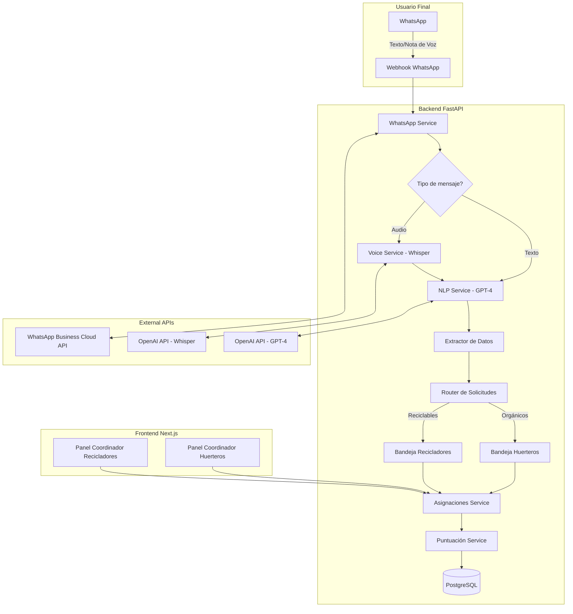
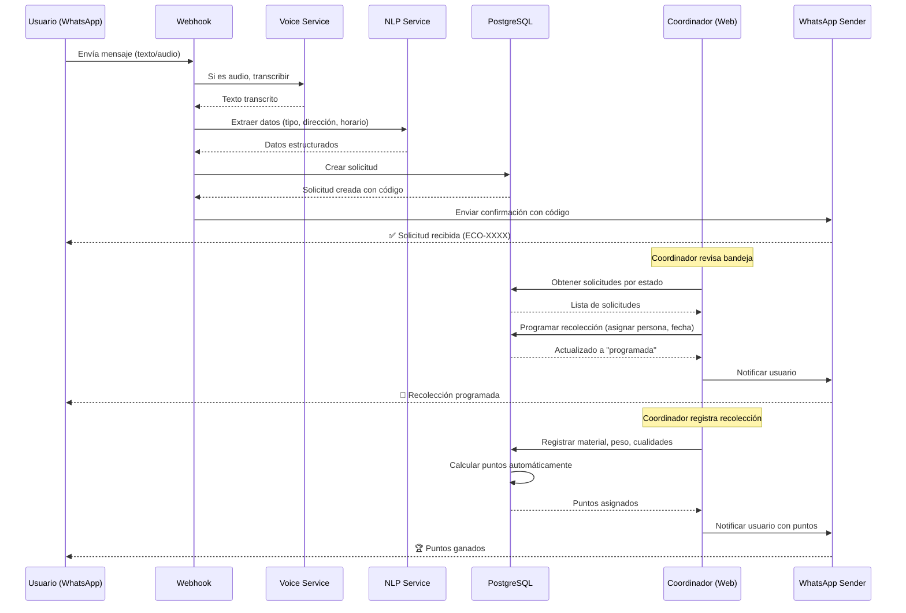

# Diagrama de Arquitectura - EcoConecta

> La IA se configura con `OPENAI_MODEL` y `OPENAI_TRANSCRIPTION_MODEL`; cualquier mención histórica a GPT-4 no es una dependencia fija.

## Arquitectura General

## Diagrama de Flujo de Solicitudes

## Componentes del Sistema

### 1. WhatsApp Service
- **Responsabilidades:**
  - Recibir webhooks de WhatsApp Business Cloud API
  - Enviar mensajes de texto y templates
  - Descargar archivos de audio
  - Verificar webhook
- **Simulador:** Para pruebas sin API real

### 2. Voice Service
- **Responsabilidades:**
  - Transcribir audio a texto usando OpenAI Whisper
  - Extraer datos clave de solicitudes usando GPT-4
  - Manejar errores de transcripción
- **Simulador:** Para pruebas sin API key

### 3. Puntuación Service
- **Responsabilidades:**
  - Calcular puntos basados en reglas configurables
  - Aplicar bonos por cualidades de entrega
  - Guardar historial de puntuación
  - Auditar cada asignación de puntos

### 4. Backend API (FastAPI)
- **Endpoints principales:**
  - `/usuarios` - Gestión de usuarios
  - `/solicitudes` - Gestión de solicitudes
  - `/colectivos` - Gestión de colectivos
  - `/asignaciones` - Asignación y programación
  - `/recolecciones` - Registro de recolecciones
  - `/puntuacion` - Reglas e historial
  - `/whatsapp` - Webhook y simulador

### 5. Frontend (Next.js)
- **Páginas:**
  - `/` - Home con acceso a coordinadores
  - `/coordinador/huerteros` - Panel de huerteros
  - `/coordinador/recicladores` - Panel de recicladores
- **Características:**
  - UI simple y rápida
  - Filtros por estado
  - Modales para programar/registrar
  - Chips para selección rápida de cualidades

### 6. Database (PostgreSQL)
- **Tablas principales:**
  - usuarios
  - solicitudes
  - colectivos
  - asignaciones
  - recolecciones
  - puntuacion_reglas
  - puntuacion_historial

## Flujo de Datos

### Solicitud de Recolección

1. **Usuario envía WhatsApp** → Webhook recibe
2. **Si es audio** → Whisper transcribe a texto
3. **NLP (GPT-4)** → Extrae: tipo_residuo, dirección, horario
4. **Router** → Determina coordinador destino
5. **Database** → Crea solicitud con estado "recibida"
6. **WhatsApp** → Envía confirmación con código único

### Programación por Coordinador

1. **Coordinador abre panel** → Filtra solicitudes por estado
2. **Selecciona solicitud** → Abre modal de programación
3. **Ingresa datos** → Colectivo, persona, fecha/hora
4. **API** → Crea asignación, actualiza estado a "programada"
5. **WhatsApp** → Notifica al usuario con detalles

### Registro de Recolección

1. **Coordinador selecciona solicitud programada**
2. **Ingresa datos rápidos** → Material (dropdown), peso (input), cualidades (chips)
3. **API** → Crea recolección, calcula puntos, actualiza usuario
4. **Database** → Guarda historial de puntuación
5. **WhatsApp** → Notifica al usuario con puntos ganados

## Tecnologías

| Componente | Tecnología | Versión |
|------------|------------|---------|
| Backend | Python FastAPI | 0.115.0 |
| Database | PostgreSQL | 15 |
| ORM | SQLAlchemy | 2.0.35 |
| Frontend | Next.js | 14.2.5 |
| UI Framework | React | 18.3.1 |
| Styling | Tailwind CSS | 3.4.13 |
| HTTP Client | Axios | 1.7.7 |
| Voice AI | OpenAI Whisper | Latest |
| NLP | OpenAI GPT-4 | Latest |
| Messaging | WhatsApp Business Cloud API | v18.0 |
| Containerization | Docker + Docker Compose | Latest |

## Consideraciones de Diseño

### Simplicidad para Coordinadores
- Menos clics posibles
- Formularios ligeros
- Selección rápida (dropdowns, chips)
- Feedback inmediato

### Escalabilidad
- API REST modular
- Servicios independientes
- Database separada
- Docker para despliegue fácil

### Mantenibilidad
- Código bien estructurado
- Migraciones de database (Alembic)
- Documentación clara
- Variables de entorno para configuración

### Seguridad
- Sin secretos hardcodeados
- Validación de datos (Pydantic)
- CORS configurado
- ORM contra SQL injection
