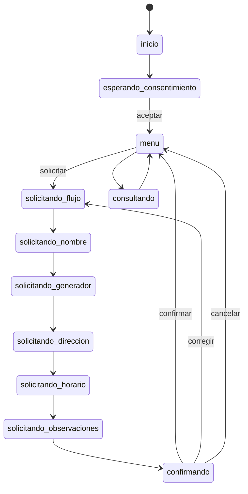

# Conversación WhatsApp

WhatsApp es el canal principal del ciudadano. La web pública solo complementa la operación y la demostración.

## Estados persistentes

La tabla `whatsapp_conversaciones` guarda el estado y el contexto JSON en PostgreSQL. La expiración es configurable con `WHATSAPP_CONVERSATION_TTL_MINUTES`. `menu`, `inicio` y `cancelar` son comandos universales.

## Consentimiento y privacidad

El primer contacto solicita autorización explícita para tratar datos y enviar notificaciones. Sin ambas autorizaciones no se crea una solicitud. `borrar mis datos` registra una solicitud para revisión administrativa.

## Solicitud

El ciudadano elige orgánicos o reciclables, entrega dirección, disponibilidad y observaciones opcionales. Antes de crear la solicitud se envía un resumen con botones `Confirmar`, `Corregir` y `Cancelar`. Solo después de `Confirmar` se crea `ECO-XXXXXXXX` y se notifica al colectivo correspondiente.

## Mensajes interactivos

Cloud API usa botones para consentimiento, flujo, observaciones y confirmación; usa lista para el menú principal. El parser también acepta texto libre y respuestas numéricas.

## Plantillas

Cuando una notificación se envíe fuera de la ventana de atención, configurar plantillas aprobadas en Meta mediante:

- `WHATSAPP_TEMPLATE_RECEPCION`
- `WHATSAPP_TEMPLATE_PROGRAMACION`
- `WHATSAPP_TEMPLATE_RECOLECCION`
- `WHATSAPP_TEMPLATE_CANCELACION`

Los nombres son variables de entorno y no contienen credenciales.
